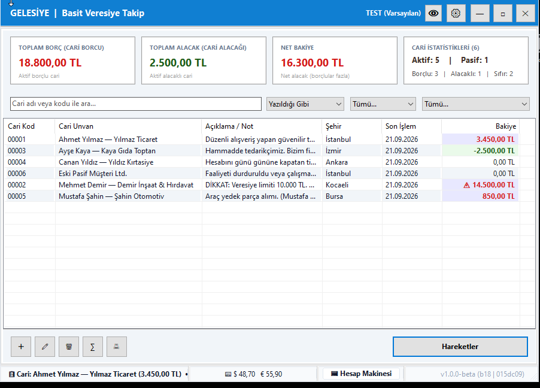
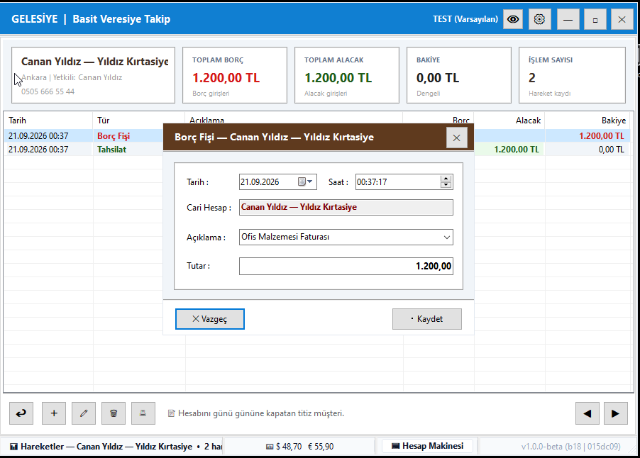

# Gelesiye (Delphi Edition) — Açık Kaynak Veresiye & Cari Takip Sistemi

**Gelesiye**, esnaf, işletme ve serbest meslek sahipleri için tasarlanmış; hızlı, güvenilir ve sade bir basit veresiye takip yazılımıdır.

Delphi 12 Community ile **Win64** mimarisinde, **MVVM** tasarım deseni, **OOP kalıtımı**, **Interface tabanlı Repository** yapısı ve **100% Standart VCL bileşenleri** kullanılarak geliştirilmiştir.

---

## 🚀 Hemen İndir ve Kur

- **Kararlı Kurulum Paketi (Stable x64):** [Gelesiye_Setup_x64.exe](releases/Gelesiye_Setup_x64.exe)

---

## 📸 Ekran Görüntüleri

### Ana Ekran (Cari Listesi & Özet Kartlar)


<br>

### Hareketler & Borç Fişi Girişi


---

## Özellikler

- **Hızlı Cari Yönetimi**: Cari kod, unvan, risk limiti, adres/iletişim bilgileri, 81 il ve ilçe seçimi ve özel notlar.
- **Hızlı Fiş Girişi & Düzenleme (Standart Kısayollar)**:
  - **F5**: Hesaba Borç Ekle (Borç Fişi)
  - **F6**: Tahsilat Yap (Alacak sütunu)
  - **F7**: Hesaba Alacak Ekle (Alacak Fişi)
  - **F8**: Ödeme Yap (Borç sütunu)
  - **F4 / Çift Tık**: Seçili fişi veya cariyi düzenle
  - **Sağ Tık Bağlam (Context) Menüleri**: Hem cari listesinde hem hareket tablosunda tüm işlemlere (ekleme, düzenleme, silme, yazdırma, yenileme) sağ tıklayarak hızlı erişim.
- **Gelişmiş Yazdırma & Makbuz / Dekont Sistemi (FastReport)**:
  - **Tahsilat / Ödeme / Borç / Alacak Makbuzu**: İşlem öncesi bakiye, işlem tutarı, işlem sonrası son bakiye ve yazıyla tutar içeren profesyonel makbuz çıktısı.
  - **Cari Hesap Ekstresi**: Tarih aralıklı, yürüyen bakiyeli ve özet toplamlı müşteri hesap ekstresi.
  - **Cari Listesi Raporları**: Özet ve hareket detaylı cari listesi raporları.
  - **Doğrudan Yazdırma & Önizleme**: Rapor önizleme penceresi üzerinden doğrudan yazıcıya gönderme veya PDF çıktısı alma.
- **Modern Tema & Konteyner Arayüzü**:
  - Aydınlık ve Karanlık mod desteği (`uGelesiyeTheme`).
  - Slate-100 yumuşak zemin üzerinde saf beyaz kartlar ve net 1px çerçevelerle yüksek kontrastlı modern görünüm.
- **Çoklu Dil & Lokalizasyon**: Türkçe ve İngilizce desteği (`uGelesiyeLang`).
- **Gelişmiş Güvenlik**: Açılış şifresi koruması (varsayılan: `gel`).
- **Modern Diyalog Sistemi**: Standart Windows mesaj kutuları yerine temalı ve estetik pencereler (`fDialog`).
- **Canlı Yürüyen Bakiye & Renklendirme**: Borçlu cariler kırmızı, alacaklı cariler yeşil/mavi renkle ayırt edilir.
- **Liste Toplamları**: Aktif/Pasif borçlu ve alacaklı toplamları tek ekranda.
- **Veritabanından Bağımsız (DB-Agnostic)**:
  - Sıfır kurulumlu, tek dosya gömülü **SQLite** desteği (varsayılan).
  - Türkiye 81 İl ve İlçe veritabanı otomatik tohumlama.
  - Test/geliştirme için tek tıkla 25 adet örnek cari ve hareket oluşturan Demo Tohumlama servisi.
  - Çok kullanıcılı ofis ve ağ için **Firebird** altyapısı.

---

## Mimari Yapı

- `src/Common/`: Ortak sabitler, tipler, versiyon, merkezi tema yöneticisi (`uGelesiyeTheme`) ve dil yöneticisi (`uGelesiyeLang`).
- `src/Domain/`: Saf nesne yönelimli varlıklar (`TCari`, `TBorcHareketi`, `TTahsilatHareketi`) ve servis arayüzleri.
- `src/Data/`: Repository ve veritabanı sağlayıcı adaptörleri (SQLite / Firebird).
- `src/ViewModels/`: VCL'den bağımsız iş ve sunum mantığı (MVVM).
- `src/Forms/`: Görsel VCL ekranları (`TfrmBase`, `TfrmBaseEdit`, `fDialog`, `fLogin`, `fAyarlar`, `fMain`).
- `tests/`: Kapsamlı otomatik entegrasyon ve birim test takımı (`GelesiyeTests.dpr`).

---

## Derleme, Test ve Kurulum

- **Uygulamayı Derleme**:
  ```cmd
  scripts\build.bat
  ```
  Derlenen çalıştırılabilir dosya `bin\Debug\Gelesiye.exe` (Debug) veya `bin\Release\Gelesiye.exe` (Release) dizinine üretilir.

- **Otomatik Testleri Çalıştırma**:
  ```cmd
  scripts\run_tests.bat
  ```

- **Kurulum Paketi Üretme (Inno Setup x64)**:
  ```cmd
  scripts\build_setup.bat
  ```
  Çıktı paketi: `releases\Gelesiye_Setup_x64.exe`. Kurulum hedefi `C:\Program Files\Gelesiye` dizinidir.

---

## Lisans

Bu proje **Ticari Olmayan Kaynak Açık Lisans (Non-Commercial Source-Available License)** ile korunmaktadır. 

Kodları inceleyebilir, eğitim veya şirket içi günlük ihtiyaçlarınız için tamamen ücretsiz olarak kullanabilirsiniz. Ancak **ticari amaçla satışı, kiralanması veya ücretli olarak üçüncü şahıslara dağıtılması kesinlikle yasaktır**. Detaylar için [LICENSE](LICENSE) dosyasını inceleyiniz.
